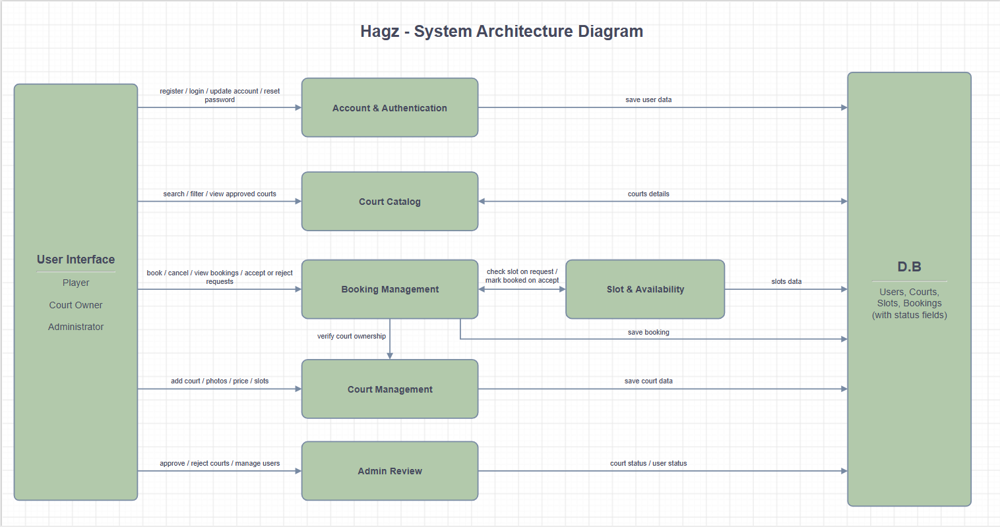
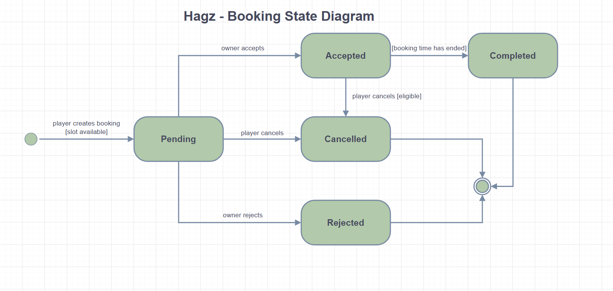

# Hagz

**Sports Court Booking & Management Platform**
*Less Searching. More Playing.*

Hagz is a web-based platform that simplifies finding, booking, and managing sports courts. It connects **Players**, **Court Owners**, and **Administrators** in one organized system.

> Software Engineering 1 (SWE1) course project — Faculty of Computers and Information, Mansoura University.

---

## Table of Contents

- [Overview](#overview)
- [Actors](#actors)
- [Features](#features)
- [System Architecture](#system-architecture)
- [State Models](#state-models)
- [Non-Functional Requirements](#non-functional-requirements)
- [Out of Scope (V1)](#out-of-scope-v1)
- [Repository Structure](#repository-structure)
- [Team](#team)
- [Course Info](#course-info)

---

## Overview

Players search and filter courts by area and price, view available time slots, and book or cancel bookings. Court owners add courts, upload photos, set prices and availability, and accept or reject booking requests. Administrators review and approve submitted courts and manage users. All users can manage their own account, including updating it and resetting their password.

## Actors

| Actor | Role in the system |
|---|---|
| **Player** | Registers, logs in, searches and filters courts, views details and time slots, books and cancels, views own bookings, manages own account. |
| **Court Owner** | Adds and manages courts, uploads photos, sets prices, defines availability, handles booking requests, manages own account. |
| **Administrator** | Logs in securely, reviews submitted courts, approves or rejects them, manages users, manages own account. |

## Features

**Player**
- Registration, login, update account, reset password
- Search courts and filter by area and price
- View court details (name, address, price, photos) and available time slots
- Create, cancel, and view bookings

**Court Owner**
- Registration, login, update account, reset password
- Add courts, manage court information, upload photos
- Set court price and define available time slots
- View booking requests, accept or reject them
- Manage court availability

**Administrator**
- Secure login, update account, reset password
- View and review submitted courts, approve or reject them
- Manage users and account status

In total, the requirements define **33 functional requirements** (12 Player, 13 Court Owner, 8 Administrator), coded as `FR-[ACTOR]-[NUMBER]`.

## System Architecture

The system is organized into six modules on top of a single database (Users, Courts, Slots, Bookings):

| Module | Responsibility |
|---|---|
| Account & Authentication | Register, login, update account, reset password |
| Court Catalog | Search, filter, and view approved courts |
| Booking Management | Book, cancel, view bookings; accept or reject requests |
| Court Management | Add court, photos, price, slots |
| Admin Review | Approve or reject courts, manage users |
| Slot & Availability | Check slot on request, mark booked on accept |



## State Models

**Booking:** `Pending` → `Accepted` / `Rejected` / `Cancelled`; `Accepted` → `Completed` (after booking time ends) or `Cancelled`.

**Court:** `Pending Review` → `Approved` / `Rejected`; `Approved` ⇄ `Unavailable`.



## Non-Functional Requirements

| Category | Highlights |
|---|---|
| Security | Password hashing, authentication, role-based access, data isolation, input validation |
| Performance | Acceptable response times, efficient queries, minimal network requests |
| Usability | Simple interface, few steps for common operations, clear messages |
| Reliability | Prevent invalid bookings, consistent booking states, graceful error handling |
| Maintainability | Modular architecture, clear responsibilities, consistent code conventions |
| Scalability | Extensible design, support for more sports, courts, users, and bookings |
| Availability | Service availability, graceful handling of temporary failures |
| Compatibility | Modern browsers, responsive layout for desktop and mobile |

## Out of Scope (V1)

Online payments, subscriptions, advertising, maps and navigation, recommendation systems, native mobile apps, advanced analytics, loyalty and rewards.

## Repository Structure

```
.
├── Hagz_Requirements.pdf            # Task 1: functional & non-functional requirements
├── Hagz_Architecture.drawio         # System architecture (editable in draw.io)
├── Hags_Architecture.png            # System architecture (image)
├── Hagz_State_Diagrams.drawio       # Booking & court state diagrams (editable)
├── Hags_State.png                   # State diagrams (image)
├── Hagz_Activity_Diagrams.simp      # Activity diagrams (SimpleUML)
├── Hagz_useCase&Sequence.simp       # Use case & sequence diagrams (SimpleUML)
└── README.md
```

> `.drawio` files open at [app.diagrams.net](https://app.diagrams.net). `.simp` files open in SimpleUML.

## Team

| Name | Role |
|---|---|
| عبدالله محمد السيد حسن السيد | Team Leader |
| علي وليد محمد عبدالعزيز قورة | Member |
| عبدالله محمد عبدالباقي السيد | Member |
| عمرو أحمد محمد عبد الرحمن صالح | Member |
| عبدالرحمن عمرو عبدالحميد محمد | Member |

## Course Info

| | |
|---|---|
| **Course** | Software Engineering 1 (SWE1) |
| **Department** | Computer Science (CS) — Third Year |
| **Faculty** | Faculty of Computers and Information |
| **University** | Mansoura University |
| **Section** | 5 |
| **Supervisor** | Eng. Liqaa Hany |
